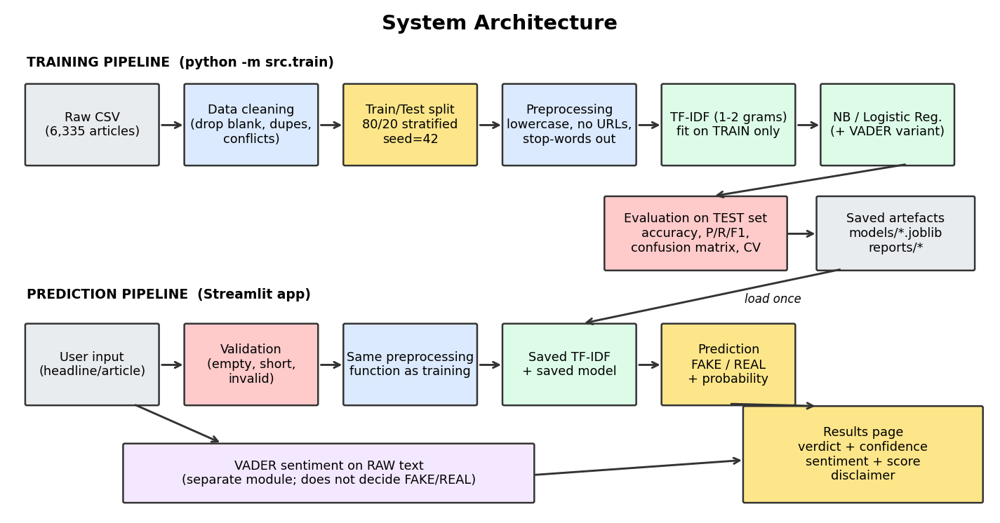
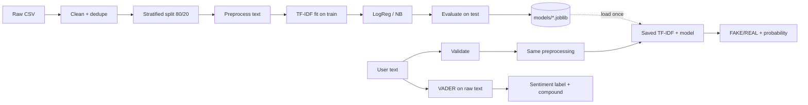

# Fake News Detection Using NLP and Sentiment Analysis

A B.Tech capstone project that classifies a news headline/article as likely **FAKE** or **REAL**
(TF-IDF + Logistic Regression) and, separately, reports its **sentiment** (VADER), through a Streamlit web app.

> **Important:** the app gives a *statistical estimate* from writing patterns. It is **not a fact-checker**.

## 1. Problem statement
Misinformation spreads quickly online and manual verification does not scale. This project investigates how well
classical NLP + machine learning can separate fake from real news articles using text alone, and whether the
emotional tone (sentiment) of an article adds useful information.

## 2. Objectives
1. Build a reproducible NLP pipeline (cleaning, preprocessing, TF-IDF, classification).
2. Train Logistic Regression (primary) and Naive Bayes (baseline) and compare them honestly.
3. Add VADER sentiment analysis and test whether it improves classification.
4. Evaluate with accuracy, precision, recall, F1, confusion matrix, cross-validation.
5. Deliver a Streamlit app that uses the *saved* model (no retraining per prediction).
6. Document limitations, including dataset bias and generalization.

## 3. System architecture




## 4. Technology stack
Python 3 · pandas · NumPy · NLTK (stop-words, VADER) · scikit-learn (TF-IDF, Logistic Regression, Naive Bayes, metrics) ·
Matplotlib · joblib · Streamlit · pytest.
Versions used for the reported results: Python 3.12.3, scikit-learn 1.8.0,
pandas 3.0.2, NumPy 2.4.4.

## 5. Dataset
* **File:** `fake_or_real_news.csv` (commonly called the "Fake or Real News" dataset), downloaded from the GitHub mirror
  `https://raw.githubusercontent.com/lutzhamel/fake-news/master/data/fake_or_real_news.csv`.
* **Format:** CSV with columns `id, title, text, label`; label is `FAKE` or `REAL`.
* **Size (raw):** 6,335 articles; REAL 3,171,
  FAKE 3,164. Median article length ≈ 597 words.
* **Data quality found:** no NaN cells, but 36 rows with blank text and
  275 duplicate article texts.
* **Cleaning applied:** dropped 36 blank-text rows and 241 duplicate texts
  (0 conflicting-label duplicates) → **6,058 articles** used. Duplicates were removed so the same article cannot
  appear in both train and test (data leakage).
* **Label assumption:** the dataset's `label` is treated as ground truth. I did not independently verify how labels were assigned.
* **Provenance caveat (verify before citing):** I confirmed the file downloads and its structure, but I did **not** verify its
  original author, collection method or license. Check the source repository and cite it properly in your report.
* **Known limitations:** contents are dominated by US politics around the 2016 election; the article-level labels may reflect
  *source* credibility rather than claim-by-claim truth; one language (English).

## 6. Methodology
1. **Cleaning** (`src/data_loader.py`): validate columns, drop blank/duplicate/conflicting rows; text = title + article.
2. **Split before fitting:** stratified 80/20 split, `random_state=42` → 4,846 train / 1,212 test.
3. **Preprocessing** (`src/preprocessing.py`): lowercase, remove URLs/HTML, regex tokenisation, keep digits, remove stop-words
   *except negations* (not, no, n't), drop 1-character tokens. No stemming. The same function is used in training and prediction.
4. **Features:** TF-IDF with unigrams+bigrams, `min_df=3`, `max_df=0.9`, `max_features=30000`, sublinear TF; fitted on training data only.
5. **Models:** Multinomial Naive Bayes (baseline); Logistic Regression (primary); Logistic Regression + 4 scaled VADER features (experiment).
6. **Sentiment** (`src/sentiment.py`): VADER on the *raw* text (it uses capitalisation/punctuation). Positive ≥ 0.05, Negative ≤ −0.05, else Neutral.
7. **Evaluation:** metrics on the untouched test set (FAKE = positive class) plus 5-fold cross-validation on the training set.

## 7. Project structure
```
fake-news-detection/
├── app/streamlit_app.py        # Streamlit interface
├── src/
│   ├── config.py               # paths, constants, hyper-parameters
│   ├── download_data.py        # downloads the dataset
│   ├── data_loader.py          # load, inspect, clean
│   ├── preprocessing.py        # text cleaning (shared by train + predict)
│   ├── sentiment.py            # VADER sentiment
│   ├── train.py                # training + evaluation + saving
│   ├── predict.py              # prediction with saved artefacts + validation
│   └── make_architecture_diagram.py
├── tests/                      # cases.py, test_all.py, generate_test_report.py
├── models/                     # tfidf_vectorizer.joblib, logreg_model.joblib, model_metadata.json
├── reports/                    # metrics.json, classification_reports.txt, top_features.csv, figures/
├── data/raw/                   # fake_or_real_news.csv (downloaded)
├── docs/                       # architecture.png, TEST_REPORT.md, CAPSTONE_EVIDENCE.md
└── requirements.txt
```

## 8. Installation
```bash
cd fake-news-detection
python -m venv .venv
# Windows:  .venv\Scripts\activate        macOS/Linux:  source .venv/bin/activate
pip install -r requirements.txt
python -m src.download_data      # downloads the dataset to data/raw/
```
(NLTK stop-words and VADER lexicon are downloaded automatically on first use.)

## 9. Commands
```bash
python -m src.train                          # train, evaluate, save models, figures and metrics
pytest -v                                    # run the test suite
python -m tests.generate_test_report         # writes docs/TEST_REPORT.md (expected vs observed)
streamlit run app/streamlit_app.py           # launch the app (http://localhost:8501)
python -m src.predict "text to analyse ..."  # optional command-line prediction
```

## 10. Results (actually measured; seed 42; 1,212 test articles)
| Model | Test accuracy | Precision (FAKE) | Recall (FAKE) | F1 (FAKE) | 5-fold CV accuracy (train only) | Train accuracy |
|---|---|---|---|---|---|---|
| Naive Bayes + TF-IDF (baseline) | 0.9290 | 0.9415 | 0.9169 | 0.9290 | 0.9109 ± 0.0064 | 0.9435 |
| **Logistic Regression + TF-IDF (primary, deployed)** | 0.9447 | 0.9334 | 0.9593 | 0.9462 | 0.9216 ± 0.0072 | 0.9728 |
| Logistic Regression + TF-IDF + VADER features | 0.9464 | 0.9309 | 0.9658 | 0.9480 | 0.9185 ± 0.0053 | 0.9713 |

**Primary model confusion matrix** (rows = actual, columns = predicted; order REAL, FAKE):
`[[556, 42], [25, 589]]` — 42 real articles flagged as fake and 25 fake articles missed.

Figures: `reports/figures/` (class distribution, three confusion matrices, model comparison, sentiment by class).
Full classification reports: `reports/classification_reports.txt`.

### What the results mean
* Logistic Regression beat the Naive Bayes baseline on test accuracy (94.5% vs 92.9%) and in cross-validation
  (92.2% vs 91.1%).
* **Sentiment did not reliably help.** Adding VADER features changed test accuracy by +0.17 points
  (about 2 article(s) out of 1,212) while *cross-validated* accuracy went down
  (0.9216 → 0.9185). That is within noise; I would not claim an improvement.
  Mean compound sentiment was +0.238 for REAL and -0.003 for FAKE, but the standard deviations
  (~0.88–0.90) are far larger than that gap, so sentiment alone cannot separate the classes. (I did not run a formal significance test.)
* **Overfitting:** train accuracy (97.3%) is higher than test (94.5%) and CV (92.2%) — a mild gap,
  typical for high-dimensional TF-IDF features.
* **Headlines are a weak spot:** when the same model was given only the *headline* of each test article, accuracy fell to
  **60.4%** (n = 1,212). The model was trained on full articles.

## 11. Limitations
* **Dataset bias / shortcut learning.** The strongest FAKE-indicating terms (`reports/top_features.csv`) include `2016`, `october`, `hillary`,
  `wikileaks`, `podesta`, `share`, `via`, while strong REAL terms include `said`, `gop`, `tuesday`, `cruz`. These reflect *topic, time period and
  website formatting*, not truthfulness. The ~94% score likely overstates real-world performance.
* **Generalisation is untested.** I have not evaluated on any second dataset, other topics, later years or other languages; expect lower accuracy.
* **Not a fact-check.** The model cannot verify claims; it only recognises statistical writing patterns.
* Probabilities from Logistic Regression are not guaranteed to be well calibrated.
* VADER is a general-purpose lexicon and can misread sarcasm and news-specific vocabulary.
* Single train/test split plus CV on one dataset; no hyper-parameter tuning was done.

## 12. Screenshots
Add your own after running the app (these cannot be generated by the code):
* `docs/screenshots/app_home.png` — app home page
* `docs/screenshots/app_result.png` — result for a pasted article
* `docs/screenshots/app_error.png` — empty-input warning

## 13. Future enhancements
Evaluate on a second dataset (e.g. LIAR) to measure generalisation; tune hyper-parameters with grid search; add
LIME/SHAP-style explanations; try transformer models (e.g. DistilBERT); calibrate probabilities; add source/metadata features; multilingual support.
